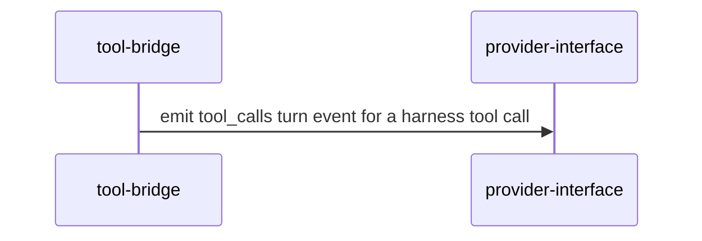

# Recap block

One block. Copy this shape and put the rollup in the summary (`composes` and low,
`extends` and medium, or `adds` and high). Label every message with what this PR does.
Prefer a sequence diagram, and add a second diagram only when it shows something the
first cannot. Participants are primitive `id`s from `docs/architecture/primitives.toml`.
Omit optional sections rather than leaving them empty.

Optional sections: **Before / after** (API shape, config, or wire-format changes as
compact fenced blocks or tables), **Invariants** (only when the change touches one from
the map), and **Plan vs actual** (when a plan-mode block existed: what shipped as planned
and what drifted).

<!-- system-recap:start -->

System recap: <b>extends existing primitives</b> (medium risk)

**Mode:** recap · **Base:** `main` @ `abc1234` · **Head:** `def5678`

**Classification:** extends. No primitives added.

### Primitives touched

| Primitive            | Group     | Impact   |
| -------------------- | --------- | -------- |
| `tool-bridge`        | claude    | extends  |
| `provider-interface` | providers | composes |

### Invariants

`tool-call-id`: tool results still match by Claude's own `toolu_` id.

### Change flow

A request carrying tool results continues the waiting session.

<!-- system-recap:end -->
